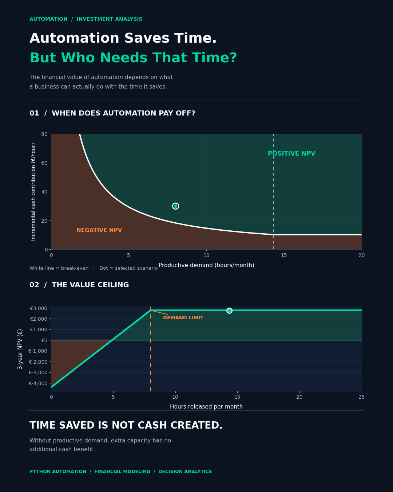

# Automation Saves Time. But Who Needs That Time?

### An NPV-Based Business Case for Reporting Automation

**Python Automation | Business Analytics | Corporate Finance | Investment Decision-Making**

---

## The Business Question

**Does saving time through automation automatically create financial value?**

Not necessarily.

Automating recurring Excel reports can release substantial employee capacity. However, that capacity only creates economic value when it can be converted into measurable financial benefits.

This project investigates the investment case for Python-based reporting automation when **productive business demand is limited**.

The central insight:

> **Time saved is not the same as cash created.**

Rather than automatically assigning a monetary value to every hour saved, the analysis evaluates how much released capacity can actually be used for economically productive work.

---

## Project Overview

This portfolio project combines a working Python reporting automation workflow with an NPV-based financial decision model.

The analysis covers:

- Automated consolidation of multiple Excel reports
- Data quality validation and reconciliation
- Automated retail performance reporting
- Python execution-time benchmarking
- Scenario-based reporting-effort comparisons
- Three-year discounted cash flow modeling
- Break-even and sensitivity analysis
- Scale-dependent implementation and maintenance costs
- Investment decision visualization

**Objective:** Determine when reporting automation is financially justified — and when additional efficiency stops generating additional economic value.

---

## 1. Python Reporting Automation

The workflow processes synthetic retail transaction data from eight stores.

### Input Data

- 8 synthetic Excel reports
- 250 transactions per store
- 2,000 transactions in total
- Reproducible synthetic data generation

### Automated Processing

The Python workflow:

1. Generates and consolidates Excel reports.
2. Validates missing values and duplicate transaction IDs.
3. Checks quantities, prices, and revenue calculations.
4. Calculates store-level and category-level performance.
5. Creates an automated monthly retail report.
6. Performs data-quality checks and reconciliation.

### Reporting Output

The automated Excel report contains five worksheets:

- Executive Summary
- Store Performance
- Category Performance
- All Transactions
- Data Quality

The workflow demonstrates how Python can support more consistent, repeatable, and auditable reporting processes.

---

## 2. Automation Efficiency Analysis

The project separates **measured technical execution time** from **estimated human reporting effort**.

| Metric | Value | Evidence type |
|---|---:|---|
| Manual reporting effort | 50 min/report | Scenario estimate |
| Automated human effort | 7 min/report | Scenario estimate |
| Estimated time released | 43 min/report | Calculated |
| Estimated human-effort reduction | 86% | Calculated |
| Python execution time | Benchmarked across 5 runs | Measured |

The 86% reduction is based on an illustrative human-effort comparison. It is **not presented as an experimentally verified labor saving**.

The Python benchmark measures processing performance separately from the human time required to prepare, initiate, and review reports.

---

## 3. From Time Savings to Financial Value

Traditional automation business cases often multiply hours saved by an hourly labor cost.

However, this approach may overstate financial benefits if payroll expenses remain unchanged and employees have no additional economically productive work to perform.

This project uses a more restrictive approach.

**Released capacity** is the reporting time made available by automation.

**Productive capacity** is the portion of released time that can actually be used to meet business demand.

**Financial benefit** is the incremental cash contribution associated with that productive capacity.

The model therefore applies:

**Productive hours = Minimum of released hours and available productive demand**

Only productive hours generate modeled incremental cash benefits.

This avoids treating unused capacity as an automatic cash saving.

---

## 4. NPV Investment Model

The financial analysis evaluates the investment over a three-year horizon.

### Core Model

**Released hours per month**

`Reports per month × Minutes saved per report ÷ 60`

**Productive hours per month**

`MIN(Released hours, Productive demand)`

**Annual cash benefit**

`Productive hours per month × Incremental contribution per hour × 12`

**Net Present Value**

`NPV = − Initial investment + Σ[(Annual cash benefit − Annual maintenance) / (1 + Discount rate)^t]`

The analysis also considers additional implementation and maintenance costs when automation is expanded across multiple reports.

---

## 5. Illustrative Investment Scenario

The featured visualization uses the following scenario assumptions:

| Parameter | Value |
|---|---:|
| Reports per month | 20 |
| Manual effort per report | 50 minutes |
| Automated human effort | 7 minutes |
| Available productive demand | 8 hours/month |
| Incremental cash contribution | €30/hour |
| Base implementation investment | €1,620 |
| Additional setup cost per report beyond the first | €50 |
| Base annual maintenance | €540 |
| Additional annual maintenance per report beyond the first | €10 |
| Discount rate | 10% |
| Investment horizon | 3 years |

### Scenario Results

| Financial indicator | Result |
|---|---:|
| Released capacity | 14.33 hours/month |
| Productively used capacity | 8.00 hours/month |
| Unused capacity | 6.33 hours/month |
| Total initial investment | €2,570 |
| Annual maintenance | €730 |
| Annual modeled cash benefit | €2,880 |
| Three-year NPV | Approximately €2,777 |

**Interpretation:** The selected scenario produces a positive NPV, but approximately 44% of released capacity remains economically unused because productive demand is limited.

All investment costs, productive demand, and incremental cash contribution values are illustrative scenario assumptions rather than observed company results.

---

## 6. The Automation Value Trap

### Interactive Decision Logic, Presented as a Two-Panel Visualization

**[View the Investment Visualization — PDF](Automation_value_trap_linkedin.pdf)**

**20 reports/month | 3-year NPV | Scenario analysis**

### Panel A — When Does Automation Pay Off?

The first panel maps investment outcomes against:

- Productive business demand (hours/month)
- Incremental cash contribution (€/hour)

The white curve represents the **NPV = €0 break-even boundary**.

The green region identifies positive-NPV combinations, while the orange region identifies negative-NPV combinations.

The highlighted point represents the selected scenario.

### Panel B — The Value Ceiling

The second panel demonstrates how economic value changes as automation releases additional capacity.

At first, more released hours can create additional value.

Once released capacity reaches the available productive demand, further time savings do not generate additional cash benefits.

**Important:** The plateau assumes fixed implementation and maintenance costs. If scaling automation requires further investment, NPV may decline even while operational efficiency continues to improve.

**[Read the Detailed Visualization Explanation — PDF](Automation_Value_Trap_Explained.pdf)**

---

## 7. Break-Even and Sensitivity Analysis

The project investigates how investment attractiveness changes under alternative assumptions.

The analysis includes:

- Different reporting volumes
- Different estimates of manual reporting effort
- Alternative productive demand levels
- Alternative incremental cash contribution rates
- Additional setup costs
- Additional maintenance costs

The model also evaluates decision thresholds such as:

**Minimum required cash contribution:** How much financial benefit must each productive hour generate?

**Minimum productive demand:** How much economically useful work must be available?

**Maximum acceptable investment:** How much can be spent before the project becomes financially unattractive?

These thresholds support more informative investment decisions than a single NPV estimate.

---

## 8. Key Findings

### 1. Operational efficiency does not automatically equal financial savings.

Reducing reporting time creates capacity, but not necessarily lower payroll expenses or additional cash flow.

### 2. Productive business demand determines the economic value ceiling.

When additional released hours cannot be used productively, their modeled incremental cash benefit is zero.

### 3. More automation is not always a better investment.

Scaling may increase capacity, but it can also increase implementation and maintenance costs.

### 4. Investment decisions require more than time-saving percentages.

NPV, break-even thresholds, productive demand, and scaling costs provide a more complete economic assessment.

---

## 9. Methodology and Assumptions

This project uses **synthetic retail transaction data** and explicitly defined financial scenarios.

### Evidence Classification

**Measured**
- Python processing time across five benchmark runs

**Estimated**
- Manual reporting effort
- Automated human effort

**Assumed**
- Reporting frequency
- Productive demand
- Incremental cash contribution
- Implementation and maintenance costs
- Discount rate and investment horizon

**Calculated**
- Released and productive capacity
- Annual cash benefits
- NPV
- Break-even thresholds
- Sensitivity results

### Limitations

The analysis is not based on confidential company information or observed company cash flows.

The financial model assumes constant annual benefits and costs, and does not explicitly model taxes, inflation, or changes in business demand over time.

A real investment decision would require verified process measurements, implementation estimates, productive demand, and evidence of incremental financial contribution or genuinely avoidable costs.

---

## 10. Repository Files

| File | Description |
|---|---|
| [01_retail_reporting_automation.ipynb](01_retail_reporting_automation.ipynb) | Python automation, benchmarking, financial modeling, and sensitivity analysis |
| [Automation_value_trap_linkedin.pdf](Automation_value_trap_linkedin.pdf) | Final two-panel investment decision visualization |
| [Automation_Value_Trap_Explained.pdf](Automation_Value_Trap_Explained.pdf) | Explanation of the visualization, assumptions, and financial interpretation |
| README.md | Project overview, methodology, and key findings |
| .gitignore | Python-related exclusions |

The notebook was developed in Google Colab and uses a Google Drive directory structure. Reproducing the workflow may require configuring project paths and generating the supporting synthetic files.

---

## 11. Tools and Skills

**Programming:** Python, pandas, NumPy, Matplotlib, openpyxl

**Automation:** Excel consolidation, automated reporting, data validation

**Business Analytics:** KPI development, reconciliation, scenario analysis

**Corporate Finance:** Discounted cash flow, NPV, break-even analysis

**Decision Modeling:** Capacity constraints, investment thresholds, scaling economics

---

## Final Takeaway

> **The best automation investment is not necessarily the one that saves the most time. It is the one that converts available capacity into measurable economic value at an acceptable cost.**

---

**Portfolio Project — Vesna Kostrewa**

[GitHub](https://github.com/VesKos) | [LinkedIn](https://www.linkedin.com/in/vesna-kostrewa/)
